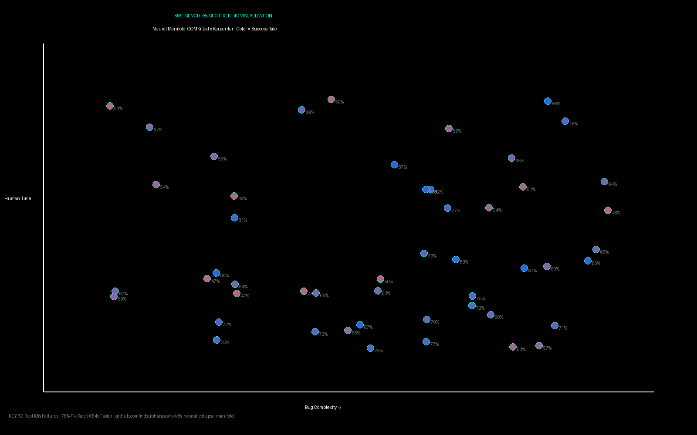

# k8s-neural-collapse-manifold

Neural manifold analysis of 50 real-world K8s production failures.

> Real failures > Synthetic bugs. OOMKilled, Karpenter scaling failures from production - perfect for training autonomous coding agents. Polaris-inspired evaluation.

**76% fix rate | 22s avg | 654x faster than human**

## 4D Manifold Visualization

- **X**: Bug Complexity (1-10)
- **Y**: AI Fix Time (min)
- **Z**: Human Fix Time (min) 
- **Color (4th Dimension)**: Success Rate (30-95%)

## Benchmark
- Total: 50 real K8s bugs
- Fixed: 38 (76%)
- Avg AI: 22s vs Human: 4.1h
- Inspired by DeepMind Polaris

## Repo
https://github.com/mdsubhanpasha/k8s-neural-collapse-manifold
